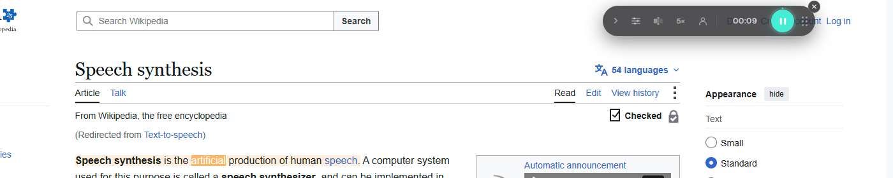
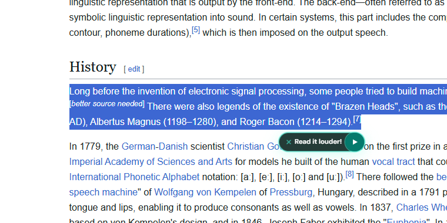
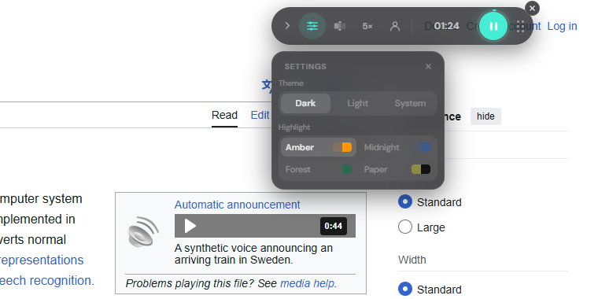
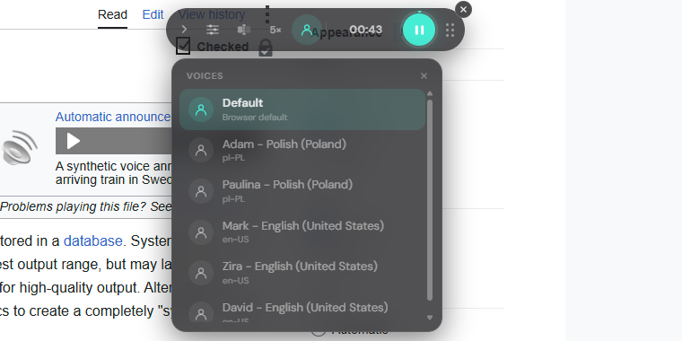

# Louder

Distraction-free text-to-speech reader for the browser. Select any text, hit play, and Louder reads it aloud — highlighting each sentence and word as it goes, so your eyes and ears stay in sync.

[](https://github.com/olaf-wilkosz/louder-extension/actions/workflows/ci.yml)
[](https://github.com/olaf-wilkosz/louder-extension/releases/latest)
[](LICENSE)


## Features

- **Read anything** — full pages, email (Gmail-aware), or just a selection
- **Word & sentence highlighting** — powered by the CSS Custom Highlight API, so nothing is injected into the page DOM
- **Selection trigger** — select 2+ words anywhere and a small "Read it louder!" pill appears next to your cursor
- **Voice picker** — pick from every voice your browser/OS offers, with automatic language detection
- **Adjustable speed** — 0.25x to 5x
- **Highlight presets** — Amber, Midnight, Forest, and Paper color themes
- **Dark / Light / System** theme, matching your OS
- **Cross-tab aware** — starting playback in one tab pauses any other tab that was reading
- **Keyboard** — `Alt` + `Shift` + `L` shows or hides the Louder panel (changeable in the browser's extension shortcuts)

## Screenshots



| Selection trigger | Settings | Voices |
|---|---|---|
|  |  |  |
| Select text anywhere — the trigger follows your cursor | Theme and highlight color, your choice | Every voice your browser offers |

## Installation

Works in Chrome, Edge and Brave 112+, and in Firefox and Zen 140+ (the Firefox build is new and not yet in daily use). Louder isn't on the Chrome Web Store or Firefox Add-ons yet. To try it now, load it as an unpacked extension:

1. Clone this repo and install dependencies (Node 22.22.2+):
   ```bash
   git clone https://github.com/olaf-wilkosz/louder-extension.git
   cd louder-extension
   npm install
   npm run build
   ```
2. Open `chrome://extensions` in Chrome (or the equivalent in any Chromium-based browser, e.g. `brave://extensions`)
3. Enable **Developer mode** (top right)
4. Click **Load unpacked** and select the `dist/chrome/` folder

**Firefox / Zen:** run `npm run build:firefox` (writes `dist/firefox/`, the same code with a Firefox manifest), open `about:debugging#/runtime/this-firefox`, click **Load Temporary Add-on** and pick `dist/firefox/manifest.json`. A temporary add-on is gone after a browser restart until the Firefox Add-ons listing is live.

## Development

```bash
npm run build          # Chrome / Edge / Brave build -> dist/chrome/ (load this folder unpacked)
npm run build:firefox  # Firefox / Zen build -> dist/firefox/
npm run package        # both builds + the store zips -> dist/louder-<version>-<chrome|firefox>.zip
npm run typecheck      # TypeScript check, no emit
npm test           # unit tests (node:test) for the text-matching and extraction logic (pure + jsdom); needs Node 22.22.2+
npm run check      # release checks: versions, store limits, permissions, bundled licenses, forbidden patterns
```

`npm run dev` (and `npm run dev:firefox`) rebuild the bundles on every change in `src/`; reload the extension in the browser after a change. The browser version numbers above live in `scripts/build-config.mjs` (one place for the bundle target, the manifest, this README and the store listing; the release checks keep them in sync).

CI (`.github/workflows/ci.yml`) runs typecheck, tests, the release checks and the build on every push and pull request, and attaches the built Chrome extension (`dist/chrome/`) and both store zips to the run as artifacts, so a PR can be tried before it is merged. Release checks guard what the stores and the privacy policy depend on: the permission list is frozen (changing it is a deliberate edit of `scripts/check-release.mjs`, the privacy page and the listing), nothing in `src/` may use network APIs, `eval` or inject HTML except from static icon constants, and every bundled third-party package must be credited in `THIRD_PARTY_NOTICES.md`.

After any change, rebuild and reload the extension from `chrome://extensions` (or refresh the specific tab you're testing on, since content scripts don't hot-reload).

The codebase is TypeScript + esbuild, no frameworks. The widget lives entirely in a Shadow DOM for CSS isolation; the selection trigger lives in its own closed Shadow DOM so its text never leaks into page-content extraction tools.

### Releasing

1. Bump the version in `manifest.json` **and** `package.json` (the checks fail if they differ) and replace `(unreleased)` in that version's [CHANGELOG.md](CHANGELOG.md) section with the date.
2. `git tag vX.Y.Z && git push --tags`. The release workflow checks that the tag equals the manifest version and the CHANGELOG section is dated, runs typecheck and tests, builds the Chrome and Firefox packages and publishes a GitHub Release with both zips attached and the CHANGELOG section as the notes.
3. Upload the zips to the stores.

## Privacy

Louder stores your preferences locally and never transmits any data. Report vulnerabilities as described in [SECURITY.md](SECURITY.md). See the [Privacy Policy](https://olaf-wilkosz.github.io/louder-extension/privacy.html) for details.

## License

[MIT](LICENSE) &copy; Olaf Wilkosz. The built extension bundles [@mozilla/readability](https://github.com/mozilla/readability) (Apache-2.0); see [THIRD_PARTY_NOTICES.md](THIRD_PARTY_NOTICES.md).
